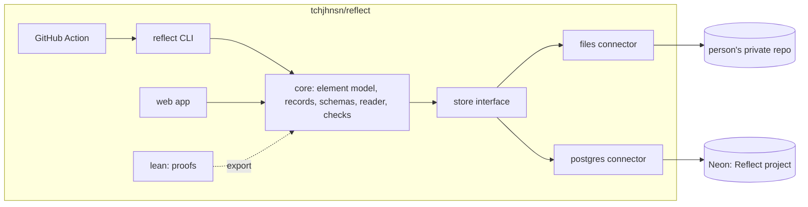

# Headless Reflect: one core, two hosts

Status: built through step 6 on 2026-11-10 (reflect#18 to #22). Not built: `encrypt: "age"`, writing grants and edges (check already refuses a grant that names entries), intents and projects as records, and the app choosing a host by `REFLECT_STORE`. Asked for by Torian on 2026-11-10 ("Let's actually design the Reflect repo this way. We can keep the app together with the headless aspect. Using our Postgres db should remain an option for where to host an instance.")

## The idea

Reflect is a personal version of Naive. Naive runs a venture's records anywhere there is a filesystem, and Mentura hosts the same records for people who have none. Reflect does the same for a person. The headless core works on the person's records. An **instance** is one person's records, and it lives on one of two hosts:

- **A git repository** the person owns (private). Entries are files, history is git, and a GitHub Action runs the reader.
- **Our Postgres on Neon**, through the Reflect app, for people who don't want a repository and for everything that needs more than one person (grants, shared intents, sign-in for Mentura and Polity).

The app and the core stay in this repository. The app is one interface over the core, and the CLI and the Action are the others.

## How the theory maps onto the layout

The table has 18 entries: Memory (0), Image (1) and 16 primes. Naive has the same split.

| Number Theory of the Soul | Naive | A Reflect instance |
|---|---|---|
| Image (1), what makes it this one | `venture.json` | `reflect.json` and `people/<id>/person.json`: who, stated telos, host |
| Memory (0), what happened, never overwritten | `provenance.jsonl` and the knowledge layer | `memory.jsonl`: an append-only, hash-chained log of every write |
| 16 primes, always present, never off | 13 functions, always true | element weights on every record |

One difference matters. A Naive record belongs to exactly one function, so ventures have a folder per function. An entry carries a weight on every element at once, so an instance has a folder per record kind and the elements are labels on each record.

## Instance layout

Since 2026-11-10 (Torian chose "plain vault, any editor"), `reflect init` writes a **vault**: the records sit at the folder's root as markdown, so the person opens the folder as is in Obsidian, VS Code or any editor. Reflect is the entryway to the ventures of a lifetime, so the vault has a folder for each, and the journal serves executing on what the person writes rather than being the end.

```
reflect.json                 host, person id, "layout": "vault"
memory.jsonl                 Memory: every write, hash-chained
person.json                  Image: name and stated facts
journal/<date>-<id>.md       the journal (a hand-written YYYY-MM-DD-*.md is an entry too)
reflections/<entry>.json     labels and self-terms; drafts beside them
concepts/<noun>.md           a concept note, made by `reflect spark`; backlinks gather every entry on it
library/                     what the person reads, listens to and studies
documents/<type>.md          custody card for an official document (the document itself need not be here)
connections/<id>.json        a service that holds records for the person, and which types
ventures/household|work|community|friendship/
telos/  intents/  grants/
```

`reflect spark` is object writing (Pat Pattison): one concrete noun, written about for 1, 5, 10 or 15 minutes or in one sentence, through the senses. The entry is kept closed with `concept: "[[noun]]"` in its front matter. Front matter the person adds (tags, aliases) is kept on every later write. Not built yet: the reader proposing concepts from an entry, the library's listening, and turning a journal entry into a venture under `ventures/work/` with Naive.

Official documents (Torian, 2026-11-11) are a custody checklist, not files Reflect must hold. Each document type says how it is normally kept today (identity mostly paper, education mostly digital) and what to do: keep the paper safe, store it digitally, or connect the service that holds it. A connection works like a Naive connection for one of its 13 functions: it names the service and the types it holds, and Reflect records only that. Not built yet: documents of other household members, reminders before a document expires, and reading anything through a connection.

The older layout below, with everything under `people/<id>/`, is still read and written when `reflect.json` has no `layout`. The person graph follows Naive#60 (`docs/design/PERSON_GRAPH_2026-11-10.md` in tchjhnsn/naive), with the names agreed there.

```
reflect.json                 host, person id, reader settings, encryption
memory.jsonl                 Memory: every write, hash-chained
people/<id>/
  person.json                Image: name and stated facts the person entered
  telos/                     the person's stated end, in their words
  intents/<id>.json          what they mean to do; holds as fields; serves -> telos
  projects/<id>.json         biography, resume, business ideas...; appraisal fields
  choices/<id>.json          a chosen means; serves_means -> intent
  entries/<date>-<id>.md     the journal: front matter + text
  reflections/<entry>.json   labels, element weights, self-terms, insight; read_against -> entry
  facts/ beliefs/ values/ places/ named/
  edges.jsonl                about, attached_to, shared_with, serves, serves_means, read_against
  grants/                    what another product may read (never entries or reflections)
```

Every record is stated by the person. A model's guess lands as a draft and becomes a record only when the person keeps it.

## The core and its interfaces



- **core** (`packages/core/`): the pure TypeScript that is in `web/src/core/` today (elements, state, `decide`, journal, packs, the structure export), plus record schemas, the reader (now `web/src/server/reader.ts`; only its Vercel OIDC token lookup stays in web) and the instance checks. No database and no Next.js.
- **store**: one interface, `read`, `list`, `append`, `write with base`, the same contract as Naive's connectors. The **files** connector reads and writes an instance folder and appends to `memory.jsonl`. The **postgres** connector is today's `journal-store`, `me-store` and `person-store`, with the migrations, per-person AES-GCM and write-once triggers unchanged.
- **CLI** (`packages/cli/`, command `reflect`): `init` (writes a vault and the workflow from `template/`), `spark` (object writing on a noun), `write` (a new entry), `read <entry>` (asks the reader, writes a draft reflection), `keep <draft>`, `check` (schemas, the memory chain, "no grant names entries or reflections"), and `export` / `import` to move an instance between hosts.
- **Action** (`action/`): a composite GitHub Action an instance repo uses. On a push that adds or changes an entry, it runs `reflect read` and opens a pull request with the draft reflection. **The pull request is the hold gate:** merging it keeps the guesses, editing it first corrects them, and closing it drops them. The correction is the diff, which is the labeling data, used for training only when the person opts in.
- **web**: unchanged for users. It imports core, and `REFLECT_STORE=postgres` (the default) keeps it on Neon.
- **lean**: unchanged. Its export still feeds core.
- **MCP** (`web/src/app/api/mcp/`): the person's own AI (Claude, ChatGPT or any MCP client) as an interface, decided by Torian on 2026-11-10 ("keep building our own app, or simply using the person's AI provider"; no Notion or Google Docs connectors). The person signs in to Reflect and allows the app; the app writes entries in the person's words and keeps only the readings the person says yes to. It runs on the Postgres host only.

`thrivesight_core/` and `api/` (the Python engine and the hackathon backend) stay as they are. Neither is part of this design.

## Choosing a host

| | Your git repo | Our Postgres (Neon) |
|---|---|---|
| Who owns the bytes | you | we hold them; per-person key |
| Write from | any editor, Obsidian, the GitHub app | the Reflect app |
| Reader | GitHub Action, with your own `AI_GATEWAY_API_KEY` or `TYPESAFEAI_API_KEY` as a repo secret | the app, through Vercel OIDC |
| History | git plus `memory.jsonl` | append-only tables |
| Grants, shared intents, sign-in for Mentura and Polity | no (not enforceable in a repo) | yes |
| Moving | `reflect export` / `reflect import` either way, the same records |

## Privacy

Entries are never published, on either host. In a private repository GitHub still stores the text. `reflect.json` can set `encrypt: "age"`: entries and reflections are then sealed with an age key, and the Action needs that key as a secret to run the reader, or the person runs `reflect read` on their own machine and the Action only runs `check`.

## Build plan

1. Move `web/src/core` to `packages/core`, make the repository a pnpm workspace, and have web import it. No change in behaviour. Vercel's root directory stays `web/`, with files outside it included.
2. Record schemas, the store interface, and the files connector with `memory.jsonl`. The postgres connector wraps today's stores.
3. The `reflect` CLI (`init`, `write`, `check`) and `template/`.
4. `reflect read` and `keep`, then the GitHub Action that opens the draft pull request.
5. `reflect export` / `import` between hosts.
6. READMEs and AGENTS.md updated with each step.

## Defaults (Torian can override any of these)

1. **Encryption is off by default** in a repo instance, so entries can be read and written in the GitHub app. The Action fails closed in a public repository: it refuses to run the reader and fails `check` when the repository is not private. `encrypt: "age"` turns encryption on.
2. **Nothing is ever served from a repo instance.** No GitHub Pages. Publishing anything (a biography section, say) is a separate, explicit copy made by the person, as in the app.
3. **Moving hosts copies, it does not sync.** After `reflect import` into Neon, the repo is left as it was, and `reflect.json` records `moved_to` so the CLI and the Action refuse new writes there. The person can archive or delete it. There is no two-way mirror.
