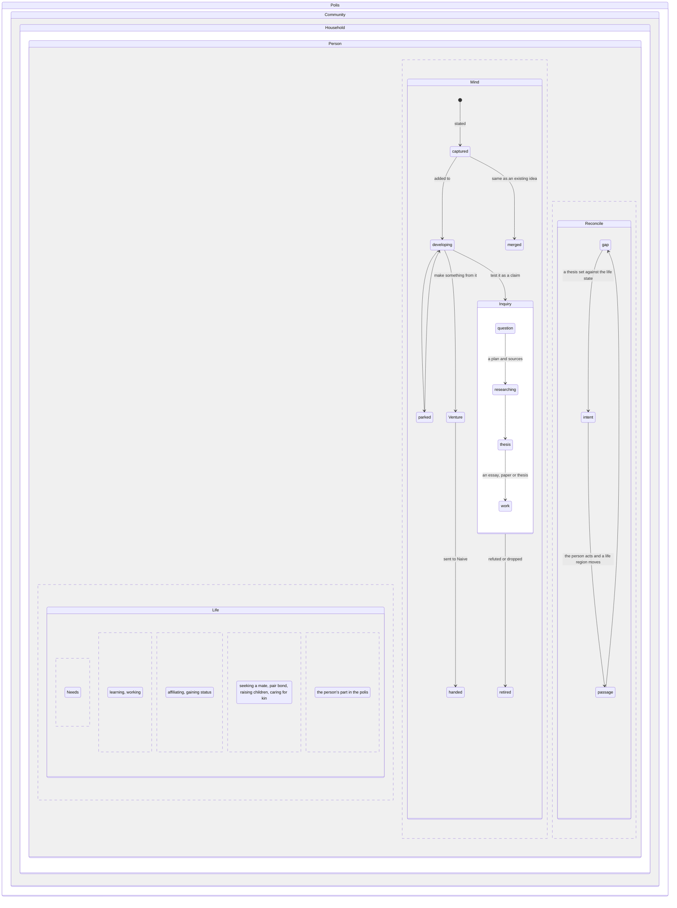
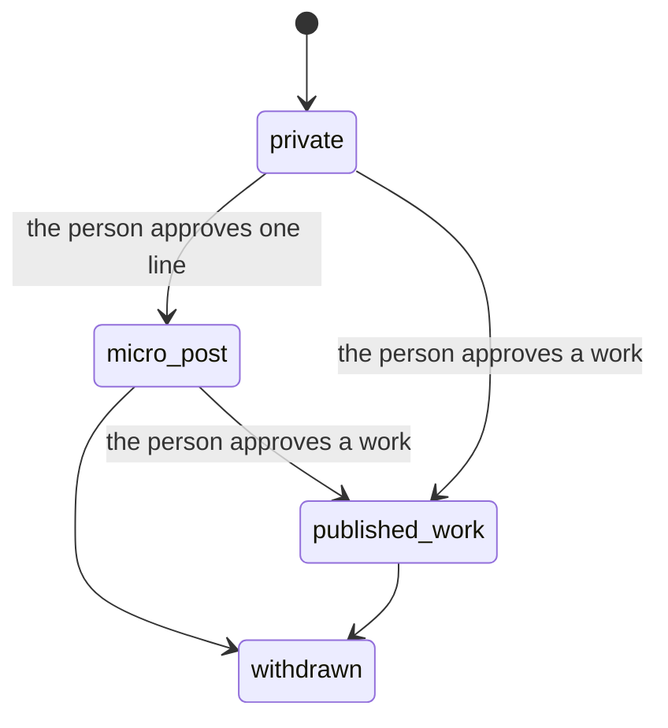

# Life and mind: domain design

Status: design, not built. Proposed 2026-11-11 from Torian's direction in the Reflect thread. Domain design says what the things are and how they move. The system design that runs it is `LIFE_AND_MIND_SYSTEM_2026-11-11.md`.

## The problem

Reflect has two jobs that have been mixed together:

1. Keeping the real state of a person's life: what they need and how it is met, who they belong with, what they know, their household, their line, their civic life.
2. Helping them form their own thinking (questions, observations, theses, essays, house codes) and turn it into work they can publish or ventures they can build.

The second job is what gets lost. Ideas are proposed again and again without being formalized. Torian: "How do you formulate your thoughts and ideas and reconcile them with your current state in life in order to progress your life towards your ideals?"

## Two layers and a bridge

- **Life** is the real state. It is observed and dated: a need met by the market, a move from seeking a mate to a pair bond, a grasp of a subject the person rated.
- **Mind** is what the person believes, thinks and proposes. It is stated in their words and never inferred.
- **Reconcile** connects them. Telos (the ideals the person states) and intents (what they mean to do) close the gap between what their mind holds should be and what their life is.

Life never holds an opinion, and Mind never holds a fact about the person's life.

## The person lives inside a polis

Aristotle, *Politics* I.2: the household comes first in time, villages form from households, and the polis forms from villages. The polis is prior by nature, as the whole is prior to the part. So the person's life sits inside household, community and polis.

Three refinements:

- **Membership, not containment.** A person can live under more than one polis, move, and belong to several communities. Each membership is dated and can be plural.
- **Living under a polis is different from working on one.** The enclosing polis is where the person lives. The polis region of their life is their part in it: voting, office, service, building.
- **The mind can belong to another city.** Augustine's two cities, and Plato's city "laid up in heaven" (*Republic* IX), describe a person who lives under one city and thinks by another. The gap is something Reconcile works on.

## Statechart

The Life regions are the ones Reflect already keeps (`REGIONS` and `NEEDS` in `packages/core/src/lifetime.ts`). This design adds Mind and Reconcile beside them.

## Ideas

An **idea** is any stated thought: a question, an observation, a thesis, a house rule. The smallest is a **micro idea**: one line that states it. A micro idea is the unit a microblog publishes.

An unexpressed idea is not a state Reflect can observe. An idea enters only when the person states it.

States:

| State | What it means |
|---|---|
| captured | Stated once, as a micro idea. |
| developing | Restated or added to. It has inputs, notes and recommendations. |
| parked | Set aside on purpose. It comes back to developing when picked up. |
| merged | The person found it is the same as an existing idea. It folds into that idea as a dated restatement. This is how a research question proposed for the fifth time joins the first four instead of starting over. |
| retired | Dropped or refuted, with the reason. Never deleted. |

### Modes

When an idea develops, the person chooses what to do with it. This is Aristotle's split between *theoria* (knowing, which answers to evidence) and *poiesis* and *praxis* (making and doing, which answer to whether the thing works for the people it serves).

- **Inquiry.** Test it as a claim: question, then research (a plan and sources), then thesis, then a work (an essay, a paper, a full thesis). Scholarly work.
- **Venture.** Make something from it and offer it. Reflect hands it to Naive, which runs the venture. Entrepreneurial work.

An idea can take both modes. A thesis on cities can lead to a venture that builds one.

### Where ventures come from

A venture has an **origin**:

- **founded**: it came from an idea.
- **inherited**: the person took it on (a family business, a trade learned by apprenticeship) before having ideas of their own about it. The ideas then point *from* the venture rather than toward it.

### Areas of life

Every idea says which areas of life it is **about** (household, line, polis and so on). That is how a person's library of theses is organized: a thesis on how they would parent and one on how they handle conflict both sit under line and household.

### Adopting

A person does not have to write every thesis. They can **adopt** one, or adopt it with changes: a house code from Ephesians 5 and 6, a rule from a church father, another person's published code. An adopted idea cites its source passage by passage.

## Publication

Publication is a track parallel to the idea's state:

The rules come from Naive's publication policy (EE-025):

- A note is never published. What goes out is an approved copy of one exact version.
- A change to the note does not change the published copy. Publishing the new version needs a new approval.
- Withdrawing hides the copy and keeps its history.
- A person approves every publication. An agent can draft and check, never approve.

The **profile** (the brag bot idea) is a view built only from what the person has published. It is never written by a model on its own.

## Works and how they relate

Standard works (*Politics*, *City of God*, *The Death and Life of Great American Cities*) and published works by people relate to each other:

| Relation | Meaning |
|---|---|
| depends on | builds on it |
| extends | takes it further or applies it elsewhere |
| complements | covers what it leaves out |
| opposes | argues the contrary |

A relation can carry a **scope** in words, because a work can depend on another overall and oppose it on one point. For example, Aristotle depends on Plato and opposes him on the Forms.

The standard works and their relations live in a **shared library**, outside any person's vault. It is kept coarse, as clusters of related works. A model can fill in the fine detail when asked, but the library does not try to hold it. A person's ideas link into the library. This is the same spectrum Reflect already uses for recommendations (supports to opposes), extended with scope.

## Open questions

1. Is the split between Life and Mind right, with telos and intents as the bridge? (Proposed 2026-11-11.)
2. Should a micro idea and its full work be one note that grows, or separate records from the start? The system design assumes one note that grows.
3. Does the shared works library live in Reflect, or in its own project the way NTS does?
4. Is a published micro idea a post in its own right, or only a teaser for a work?
5. Can a merged idea be split again if the person finds it was two ideas?
