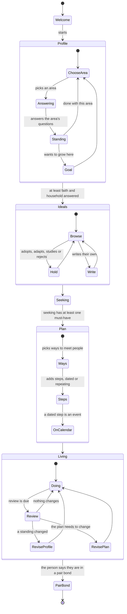

# Preparing for a partner: domain design

Status: design, not built. Proposed 2026-11-12 from Torian's direction in the thread "Build dating into Reflect". Domain design says what the things are, how they move and what the system must and must not do. The system design that runs it is `PREPARING_FOR_A_PARTNER_SYSTEM_2026-11-12.md`.

## The problem

Dating apps start at the match. They ask for photos and a short bio, then show you people. They say nothing about whether you are ready to build a household, and nothing about how you mean to find someone beyond swiping.

Reflect starts earlier. Torian: "It is a personal development tool, not only so that you can go on dates and find dates, but that you can first develop yourself to be prepared for the date, or just also be aware of your areas of development."

So dating is the way in, not the whole of it. A person seeking a mate is asked about their faith, health and fitness, money, work and their picture of a household. They see where they stand and where they want to grow. They write what they are looking for, plan how they will look for it, and put the plan on their calendar.

## Who it is for first

Christians who are single and want to marry. The content is written for them first: the questions, the example codes and the sources they cite (Scripture, church history, Christian writers). The model under it does not assume a tradition. Tradition is a field on the profile and a tag on content, so other traditions can get their own content later without changing the model.

## The concepts

| Concept | What it is | Who writes it |
|---|---|---|
| **Profile** | The person's answers about themselves, one area at a time. | The person |
| **Area** | A part of life the profile covers: faith, health and fitness, money, work, household and children, character and habits, family of origin. | Fixed list, Reflect's |
| **Standing** | Where the person says they are in an area now, dated. A later standing adds a line and never replaces the earlier one. | The person |
| **Development goal** | Something the person wants to grow in within an area, with a measure they choose. | The person |
| **Ideal** | A thesis about dating, marriage or household. Written by the person or adopted with a citation. Held as wrote, adopts, adopts with changes, studies or rejects (from the library design, reflect#47). | The person |
| **Seeking** | What they are looking for: must-haves, dealbreakers, hopes. Dated lines. | The person |
| **Plan** | How they mean to find it: the ways they will meet people (church, introductions by friends and family, events, groups, apps), how often, and the steps. | The person |
| **Step** | One thing in the plan, with a date or a repeat. A step with a date is a calendar event. | The person |
| **Review** | A check-in at an interval the person picks: what steps they did, whether a standing changed, whether the plan needs to change. | The person |
| **Person met** | Someone they are getting to know, with a stage. Held back from v1 (see non-requirements). | The person |

Nothing in the table is inferred. Reflect asks, and the person answers in their words or picks an option. A model may suggest a question or a source, and a suggestion stays a suggestion until the person keeps it.

## Ideals are held at three levels

Torian named three: ideals the person holds, ideals the other person may hold, and ideals held generally.

- **Mine** is an ideal with the person's own hold on it.
- **Generally held** is the shared library: codes and theses with their citations, which anyone can read and adopt. Reflect seeds it for Christians first (for example courtship before dating, chastity before marriage, the husband's and wife's callings in Ephesians 5, singleness as a gift in 1 Corinthians 7), each with its source and the traditions that hold it.
- **Theirs** is what the person hopes a partner holds. It is written as seeking lines that point at ideals: "must hold [[chastity before marriage]]", "hope holds [[family worship]]". It is never a claim about a real person.

Two ideals can conflict. The library records that one opposes another, so the person can see where their own holds disagree.

## Work: telos and subsistence

Torian: work can serve a person's life telos, or it can be for self-subsistence only, or both, by degrees.

Each piece of work the person does gets two answers, asked separately because neither follows from the other:

1. **Telos weight.** "How much does this work serve [the telos they stated]?" Answered on a five-step scale: not at all, loosely, partly, mostly, wholly. When they have stated more than one telos, they answer for each.
2. **Subsistence.** "If your needs were met another way, would you keep doing this work?" Yes, in part, or no.

The two answers place the work without a label the person has to accept:

| | Would keep doing it | In part | Would stop |
|---|---|---|---|
| Serves telos mostly or wholly | Vocation | Vocation with a cost | Telos work they can't afford to keep (worth a look) |
| Partly or loosely | Mixed | Mixed | Mostly for subsistence |
| Not at all | Kept for its own sake (a craft, a calling not yet named as telos) | Subsistence | Subsistence only |

The cell is computed on read from the two answers, never stored. A venture built with Naive is work too; its telos weight is asked the same way.

## The person's way through

Every region can be reopened at any time; the arrows are the first pass, not gates. The guards on the first pass are deliberately light: Ideals opens once faith and household are answered because seeking lines point at ideals, and Plan opens once there is a must-have because a plan to find nothing in particular is not a plan.

Moving to a pair bond is a passage the person keeps in `life/passages.jsonl`, the same as today. The profile, ideals and goals carry over: the preparation was never only for dating.

## Requirements

R1. The person builds a profile area by area, in any order, and can stop and return.
R2. Each answer is dated and kept. A changed answer adds a line; earlier lines stay readable.
R3. For each area the person can record a standing and any number of development goals, each with a measure they choose.
R4. The person can browse a library of ideals with citations, and hold any of them as wrote, adopts, adopts with changes, studies or rejects.
R5. The person can write an ideal of their own, citing sources from their `learn/` notes or by name and link.
R6. Seeking is must-haves, dealbreakers and hopes, each a dated line that may point at an ideal.
R7. The plan lists ways to meet people and steps; a step has a date, a repeat rule, or neither.
R8. Every dated step appears on the person's calendar and can be exported as iCalendar (.ics).
R9. A review comes due at the interval the person picks and asks what was done and what changed.
R10. Work records carry telos weight per stated telos and the subsistence answer; the cell is computed on read.
R11. All of it is stored in a database per person (hosted mode) and can be written to and read from the person's vault as files (local mode), with the same meaning in both.
R12. Personal values are sealed at rest, as the journal is today.
R13. Christian content first: questions, example ideals and sources written for Christians; tradition is a field and a tag, never a hard-coded assumption.
R14. Nothing about the person is inferred. A model may suggest; only the person keeps.

## Non-requirements (v1)

N1. No matching. Reflect does not show people to each other, rank them or suggest a partner.
N2. No profiles visible to other people. Nothing in this feature is published; a person may later publish an ideal or essay through the publishing gate, which is separate.
N3. No records about real people the person is dating (Person met). That needs a privacy rule first, because it holds someone else's information.
N4. No anonymous forum yet. It is a nice-to-have, designed later (see below).
N5. No two-way sync with Google, Outlook or Apple calendars. Export and a private subscription feed only.
N6. No scores. Reflect does not compute a readiness score or grade a person's standing.
N7. No messaging, no photos, no verification of identity.
N8. No denominational adjudication: Reflect cites what a tradition holds and does not rule which is right.

## The forum, later

Torian: an anonymous forum where people ask the questions they want answered. It is a nice-to-have. When it comes, three constraints follow from the rest of this design: posts are anonymous to other members but tied to an account for moderation; a question can become a profile question only when a person on the team keeps it; and an answer that states an ideal can cite the library. Its moderation and safety rules need their own design.

## Open questions

1. **Tradition scope.** Christian first: one set of content for all Christians, or variants for Protestant, Catholic and Orthodox where they differ (for example on marriage as a sacrament)? Recommended: one set, with each ideal tagged by the traditions that hold it.
2. **The areas.** Faith, health and fitness, money, work, household and children, character and habits, family of origin. Missing or extra?
3. **Telos weight scale.** Five steps (not at all to wholly), or a slider from 0 to 100?
