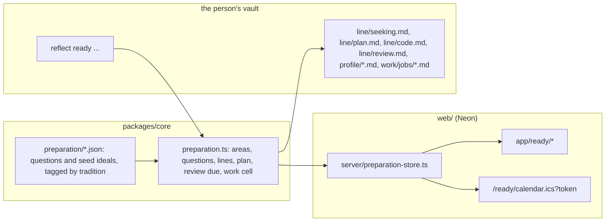

# Preparing for a partner: system design

Status: design, not built. Runs the domain in `PREPARING_FOR_A_PARTNER_DOMAIN_2026-11-12.md`.

## Shape

One core, two hosts, as `HEADLESS_REFLECT_2026-11-10.md` set out.



All rules live in core: which questions an area asks, how lines fold into a current state, when a review is due, and which cell a piece of work sits in. Each host only stores and shows.

## Lines, not rows that change

Every record is a list of dated lines, the same pattern ideas, needs and documents use now. A line is never edited. The current state is folded from the lines on read. This gives R2 (answers kept) for free and makes the database and the vault hold the same thing.

| Record | One line says |
|---|---|
| Profile answer | on, area, question id, answer |
| Standing | on, area, the person's words, optional level they picked |
| Goal | on, area, goal id, text, measure, state (open, met, dropped) |
| Ideal hold | on, ideal ref, hold (wrote, adopts, adopts-with-changes, studies, rejects), changes |
| Seeking | on, kind (must, dealbreaker, hope), text, optional ideal ref, or `dropped` |
| Plan way | on, way (church, introductions, events, groups, apps, other), cadence, or `dropped` |
| Step | on, step id, text, date or RRULE, duration, state (planned, done, skipped, dropped) |
| Review | on, steps done, standings changed, plan changes, note |
| Work | on, work id, title, kind (job, venture, unpaid), telos weight per telos, subsistence answer |

## Hosted: Neon

Migration `0012_preparation.sql`, in the style of `0011_ideas.sql`: one table per record with `user_id`, an id, a few plain columns the app filters on, and `body_ct` sealed with `crypto.ts` `seal` for anything the person wrote.

```
prep_line (id, user_id, record text CHECK (record IN ('answer','standing','goal','hold','seeking','way','step','review','work')),
           key text, on_date date, body_ct text, created_at)
prep_feed (user_id PRIMARY KEY, token_tag text, created_at)
```

One table is enough because every record is lines with the same envelope; `record` and `key` (area, goal id, step id, work id) are the only columns queries need. An append-only trigger forbids UPDATE and DELETE on `prep_line`, as the DAG rule asks elsewhere. Seed ideals are not stored per person; they ship as content in core, and a person's hold points at them by id.

Migrations run on the dev branch for local work. Preview and production wait on Torian's go-ahead, as before.

## Local: the vault

The same lines as Markdown with front matter, written by core:

- `profile/<area>.md`: answers, standings and goals for one area. `profile/` is a new top-level folder, because the profile covers the whole life, not only the line.
- `line/seeking.md`, `line/plan.md` (ways and steps), `line/code.md` (holds on ideals, as links to `ideas/` notes for ideals the person wrote), `line/review.md`.
- `work/jobs/<id>.md` for a job or unpaid work. A Naive venture stays a folder under `work/`; its telos weight goes in a `reflect.md` beside it so Naive's own files are untouched.
- `line/calendar.ics`, rebuilt from the steps.

`reflect ready` shows where the person is in the way through; `reflect ready answer|stand|goal|hold|seek|way|step|review|work` writes one line each.

## Calendar

Steps become VEVENTs (RFC 5545), with RRULE for repeats and the step id as UID so a re-export updates instead of duplicating. The hosted app offers a download and a private subscription URL: the token is random, only its keyed hash (`tag`) is stored, and the person can reset it. The feed carries step text only, never profile answers. This is the export-only first step of the calendar component designed for Naive on 2026-10-29; two-way sync stays out (N5).

## Screens (built locally first)

Built with `pnpm --filter web dev` against the dev Neon branch, then checked with `preview`.

| Route | Shows |
|---|---|
| `/ready` | The way through: each region with what is done and what is next, and a review when one is due |
| `/ready/profile/[area]` | The area's questions one at a time, then the standing and goals |
| `/ready/ideals` | The library: filter by topic and tradition, hold or write one, see conflicts with your holds |
| `/ready/seeking` | Must-haves, dealbreakers, hopes, each able to point at an ideal |
| `/ready/plan` | Ways and steps; a step with a date shows on a month view |
| `/ready/review` | The check-in |
| `/ready/work` | Each piece of work with its two answers and the computed cell |

The screens use the existing themes and the Me page's patterns. No score appears anywhere (N6).

## Build order

Each is one PR with tests.

1. Core: `preparation.ts` model, areas and questions for Christians, lines and folds, the work cell, review due. Vault files and `reflect ready`.
2. Seed ideals with citations (about twenty), each tagged with topic, traditions and the ideals it opposes.
3. Hosted store and migration 0012 (dev branch only), MCP tools to read and write lines.
4. Screens: `/ready`, profile, seeking.
5. Screens: ideals, plan with month view, `.ics` export and feed.
6. Review and work screens.

Not built in any of these: matching, people met, the forum, two-way calendar sync.
