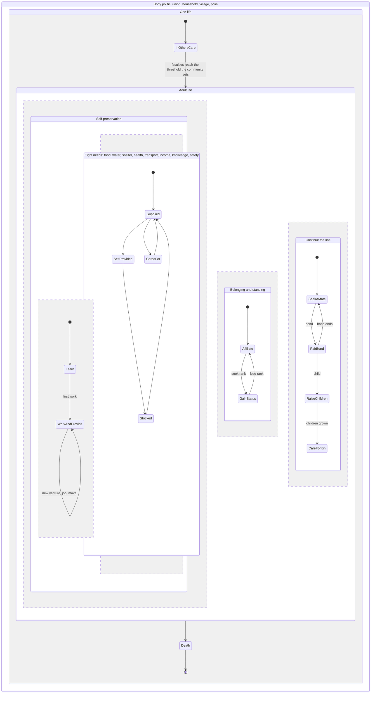
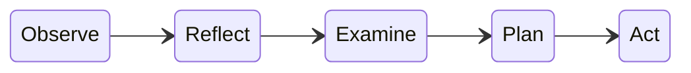
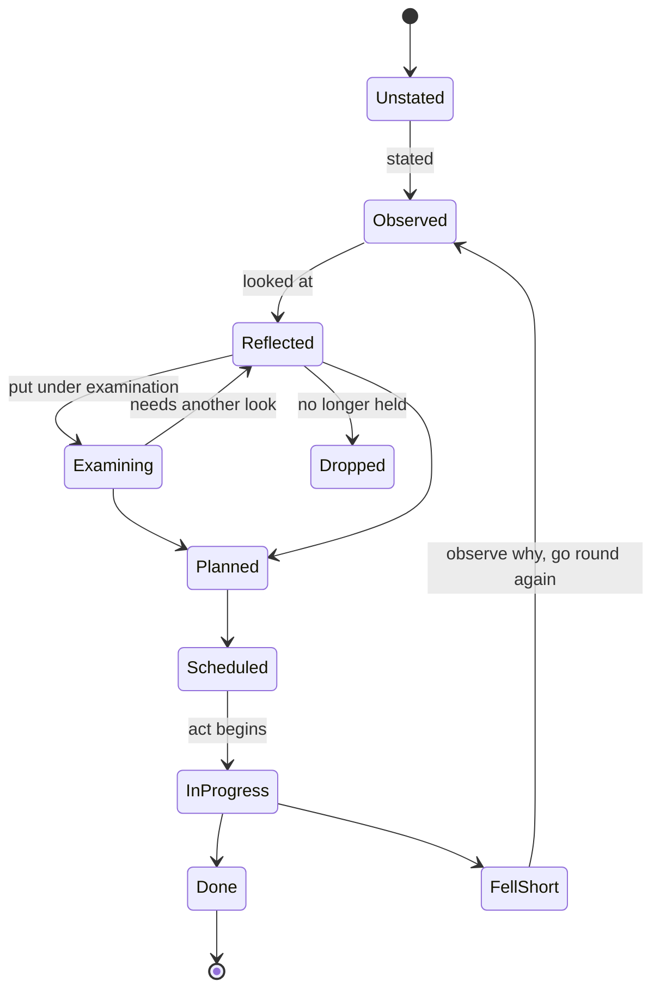

# Reflect: domain design

Status: domain design in progress, nothing built. Started 2026-11-12 from the discussion with Torian in the thread "Design partner preparation in Reflect". Each point is marked **Decided** (Torian said it) or **Proposed** (Claude suggested it, not yet confirmed). Nothing moves from proposed to decided without Torian saying so. The system design comes after this document is settled, and the interface after that.

## What Reflect is

**Decided.** Reflect is a whole-life platform, not a tool for one part of life. A person works through the domains of their life: what they believe about each, where they stand, what they mean to do and what they are doing. Two sides:

- a static side, where a person writes their files across the life domains and can export them as a file system;
- an operational side, where they run and manage the parts of life they have thought through.

Other users interacting on the platform is wanted, later.

**Decided.** "Life operating system" is a reference, not what we are designing. Products under that name are similar, but our intents differ (Torian's working assumption, to be tested). A study of those products (what they do and don't do, how they are built, what to adopt and where we differ) is a later step. Products noted so far for that study: Life OS templates and apps (PARA, Wheel of Life, Griply, LifeGrid), Lifebook (premises, vision, purpose and strategy per category), Ray Dalio's five-step process, Michael Hyatt's life plan, Covey's roles.

**Decided.** The audience a venture serves first is a go-to-market concern and stays out of this design. The domain design grounds itself in Aristotle.

## The domains

**Decided.** The domains are the ones the Ventures of a Lifetime already expresses. They are not formalized as a system yet; this document starts that.

From the Ventures of a Lifetime chart and the Life State Machine (both earlier work, recorded here as the starting point, not re-decided):

- **One life** starts in others' care. The passage out is a threshold of mental and physical faculties that the community sets; age is only its proxy.
- **Adult life** runs regions at the same time:
  - **Self-preservation:** learn, then work and provide; eight needs (food, water, shelter, health, transport, income, knowledge, safety), each self-provided, stocked, supplied or cared for, by the person, the market, nature, the polis or kin.
  - **Belonging and standing:** affiliate, gain status.
  - **Continue the line:** seek a mate, pair bond, raise children, care for kin.
- **The body politic** encloses the life: union, household, village, polis (Aristotle, *Politics* I.2).
- **Death** is the single final state. Legacy is prepared for it.

The needs region shows its four ways of being met, not a fixed order; a need moves between them as life changes. Each child starts a new life inside the same body politic.

The vault Reflect writes today (`reflect init`) already lays these out as folders: life, needs, learn, ideas, work, belonging, line, household, community, polis, legacy.

## The pipeline

**Decided.** Five phases, and they are the pipeline for the whole system, not only for beliefs:

1. **Observe:** state what is, for example what you believe about something.
2. **Reflect:** now that it is stated, do you still hold it?
3. **Examine:** put it under scrutiny, by discussing it with others or otherwise, constructively, or by boiling it down to first principles. (The name Examine is decided; "test" and "scrutiny" were set aside.)
4. **Plan:** decide how to carry it out.
5. **Act:** carry it out.

**Decided.** A state machine follows every nested item across all domains and shows where it sits: not yet stated (so nothing observed), observed but not reflected on, under examination, planned, or in action, and the status of the action.

**Decided.** Examine can send an item back. That does not mean the person comes away believing something different. Examination may reinforce a belief, ground it in something more fundamental, leave it unchanged, or change only how it is communicated or structured.

### The cycle moves through life stages

**Decided.** It is a cycle, but a cycle through the life stages. The aim is to move on, not to loop. In seeking a mate, a date is an act. If it is not successful, the person goes back through the cycle (observe why, reflect, examine) so the next date does not repeat the same mistakes. The trap to avoid is endless dates that never become more ("the Tinder trap"). When a partner is found, the next stage follows, and household planning ideally has already begun. Wedding planning matters little; at most a list of what the couple needs that others can give.

**Proposed.** A loop that repeats without change is a signal: when the same reason for falling short comes up again, Reflect puts it in front of the person.

### Item states (proposed)

Scheduled, in progress, done and fell short are the statuses of Act. Only done leaves the cycle; fell short always goes back to Observe.

- **Unstated** is a hole, not a record: a question the domain expects answered that has no answer yet.
- Reflect's outcomes: held, revised, unsure, dropped. A dropped item leaves the pipeline and stays in the record.
- Act's statuses: scheduled, in progress, done, fell short.
- Items nest domain, then area, then item. A level's status is the count of its items in each phase, computed, never set by hand.
- Whether Examine may be skipped (Reflected straight to Planned) is open.

### Examine: steps and outcomes (proposed)

Steps: state it precisely (Naess's precization); ground it, asking why until a first principle is reached; set it against things (the strongest opposing case, the evidence, the person's other beliefs, as in Rawls's reflective equilibrium); take counsel from others; settle it.

Outcomes, on two axes that change independently:

- what is believed: kept, qualified (true under conditions; Toulmin), revised, withdrawn, or suspended (Socratic aporia); after Alchourrón, Gärdenfors and Makinson's belief revision (1985);
- how it stands: grounded (rests on a deeper principle, which becomes an item of its own), reinforced (more reasons), restated (said or structured better).

## Origins

**Decided.** An item need not have a belief at its root. It may spring from a plan, a telos, a need, or elsewhere. Origins are Aristotle's seven causes of action (*Rhetoric* I.10), in his grouping:

| Not from the person | From the person |
|---|---|
| chance | habit |
| nature | reasoning |
| compulsion | anger |
| | appetite |

Beliefs, telos and plans fall under reasoning.

**Decided.** The Number Theory of the Soul maps onto these origins; Reflect never depends on it. The mapping and Torian's ruling (sensors feed drivers and regulators and can override regulators; regulators are trained over development) are filed with NTS (tchjhnsn/NTS#3).

**Open.** Can an item have more than one origin? (A job can come from appetite, for income, and reasoning, for a vocation.)

## Observations: stated or connected

**Decided.** Some observations come from connections instead of the person: income from a bank account or payroll, for example. As in Naive, the design decides where tools and connections supply information and how it is fetched, instead of rebuilding them. What must be observed or stated differs by domain.

**Proposed.** Each observation records its source, stated or connected, and Reflect keeps only the fact it needs. Each domain lists what it needs observed and which connections could supply it.

## Telos per domain: finance first

**Decided.** The default financial telos is self-sustainability, defined as a livable income, using MIT's Living Wage Calculator from where the person lives and their situation. Not everyone shares this telos; some are content with work that only pays the bills.

**Decided.** Planning takes the person's current situation into account. Example: someone aged 18 or 19, at community college, living with their parents, earning 16 dollars an hour. Their needs are met for now. Their goals are to graduate, get a job, and support themselves and a family. Examine asks whether they are on trajectory for that plan, and which parts of it are already in action.

**Proposed.** The livable wage is computed for the household the person is heading toward, where and when they expect to need it, not only the one they are in. MIT's data is licensed for products; terms to check before the system design relies on it.

**Decided (from the earlier dating discussion).** Work is weighed two ways: how much it serves the person's telos (by degree, along a scale), and whether it is only for self-subsistence (whether they would keep doing it if their needs were met another way). Work can be both.

## Subdomains, one at a time

**Decided.** The domain design proceeds domain by domain, subdomain by subdomain. Income comes first, because what comes with entering independence of mind and body comes before seeking a mate.

**Proposed.** Each subdomain answers the same six questions: what is observed (stated or connected); its default telos; typical items and their origins; its states and gates; what Examine looks like there; the shape of its plans and of running them.

### Income

**Decided.** The state observed is the person's movement toward self-sufficiency and then toward others being able to depend on them: where they are now against that state. Once self-sufficient, they prepare for how many people they want depending on them (for example, a wife who does not have to work and many children): can they sustain that now, and what must be done so they can.

**Decided.** The intended household (spouse working or not, how many children) is stated in the line and household domains; income reads it to set its target.

**Decided.** Donations count. Young families often have many things donated, so not everything has to be provided directly by income.

**Decided, later.** A pipeline for requesting things a family needs and cannot provide at a phase of life (furniture, a month's supply of diapers for a new family), filled through church and charity partnerships, something like a marketplace for needs. Torian wants this visible; it is back-burnered for now.

**Proposed.**
- Capacity is the largest household the person's income sustains where they live, priced with MIT's household configurations (adults, working adults, children; MIT stops at three children, so larger families need an extension). The target is the intended household. The gap drives Plan.
- What donations cover lowers what income must cover: each need records its providers, and gifts from community, church or charity join the existing providers (self, market, nature, polis, kin).
- Observed: income sources, amounts and regularity (stated), or deposits, pay stubs and tax forms (connected).
- Examine: on track for the intended household by when it is needed; how fragile the income is (sources, runway).
- Plan: intent, milestones (graduate, first full-time job, self-sufficient, sustains the intended household), steps. Run: income observed monthly against the trajectory, with the fell-short loop.

### Work and provide

**Decided.** Unpaid work counts as work: maintaining a family is a full-time job (preparing meals, cleaning, caring for the children, being at practices and recitals, bathing and feeding them). Later designs may show how much work a given responsibility requires. This also lets a couple evaluate a babysitter or daycare, and homeschooling against public, charter or private school.

**Proposed.**
- Each piece of work is paid or unpaid, with its role, hours and since when; paid work feeds income. Connected sources: payroll, an imported LinkedIn profile, ventures run in Naive.
- No default telos of its own: work serves income's telos and the life telos, weighed by telos and by subsistence (decided earlier).
- States: learn, then the gate of first work, then work and provide (new venture, job or move loops back); each piece of work is seeking, working, between work or ended.
- Examine: does it serve the telos, would you keep it, is it on track for income's target, what would you need to learn (hands off to Learn).
- Household work is a set of tasks, each provided the way needs are: by a member (unpaid), bought (a babysitter, daycare, a school) or given (family, church, charity). A make-or-buy comparison weighs a member's hours against the cost of buying the task (economists value household production by replacement or opportunity cost). The concept is set here; the detail (childcare, schooling choices) is designed in the household and raise-children subdomains.

## Plans in phases

**Decided.** A plan has phases, and the person chooses how detailed each phase is, because some people want detailed plans and others do not.

**Proposed.** Three levels, after rolling-wave planning and commander's intent: intent (why, tied to the telos), milestones (what, by roughly when), steps (scheduled actions, on the calendar). Default: the current phase in steps, later phases in milestones. Dated steps go on the person's calendar.

## Open questions

1. What an item holds and how items relate (parents, origins). Next to settle, since the rest hangs on it.
2. The formal life stages: which stages, which domains and questions each opens, how the next stage opens early, and who decides a stage is done (proposed: only the person).
3. Reflect's, Examine's and Act's outcomes and statuses above (all proposed).
4. For each domain beyond finance: what is stated, what is connected, and its default telos.
5. Other people: what they can see and do, for counsel in Examine and for interaction on the platform.
6. Whether an item can have several origins.
