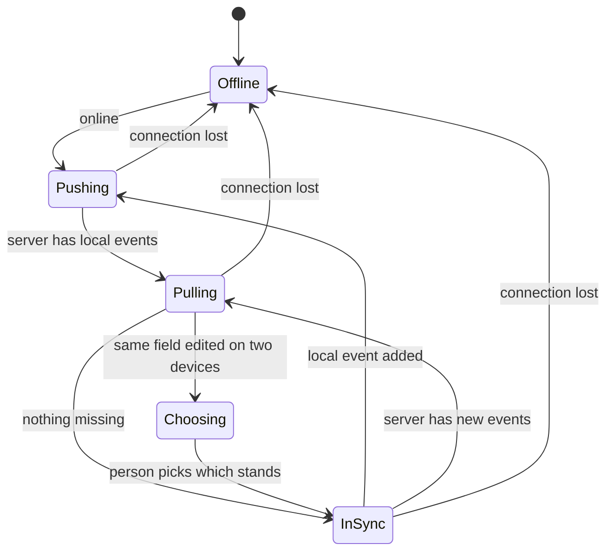
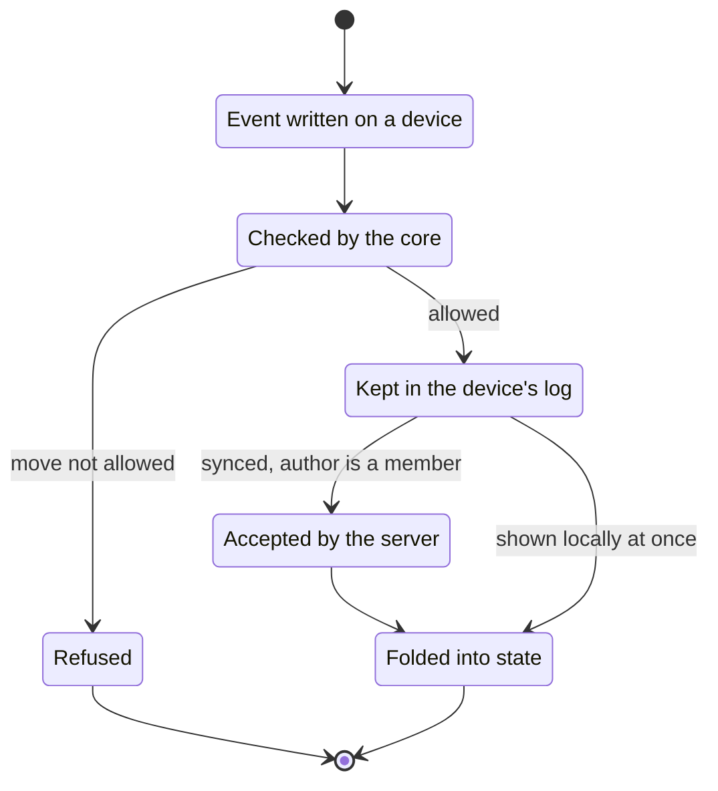

# Reflect: system design

Status: system design complete as a first pass, nothing built. Started 2026-11-12, after the domain design (`REFLECT_DOMAIN_2026-11-12.md`) was settled. Each point is marked **Decided** (Torian said it) or **Decided on recommendation** (Claude recommended it and Torian delegated the rest of the system design on 2026-11-12: "I trust your insights. Continue all the way through."). Either can be reopened.

Order, by what depends on what: (1) where records live, (2) record layout, (3) the state machine, (4) standards and connections, (5) what leaves, (6) architecture, (7) security and privacy, (8) build order. The interface (UI/UX) comes after this document.

## 1. Where records live

**Decided.**
- Hosted is the record: the website holds every vault (private, joint, household, village), and any vault can be exported as a plain file system at any time.
- Records sync both ways between hosted and local, and the same holds for a mobile app if one is made.
- The core keeps running on plain files, so a local copy is a working vault, not only a backup.
- Every change is an event: dated, with who made it and on which device, added to the item's history and never edited. An item's current state is computed from its events. Sync exchanges the events each side is missing.
- When two devices edit the same field of the same item before syncing, Reflect keeps both versions and asks the person which stands. Nothing is silently dropped.

**Decided on recommendation.**
- Events carry the domain's "history only added to, never overwritten" into storage; two devices adding events never conflict, only edits to the same field can.
- Local and mobile copies work offline and sync when back online.
- Shared vaults sync to each member's devices; a member sees only the vaults they belong to.

## 2. Record layout

**Decided.** A hand edit to a note (in any editor, such as Obsidian) becomes an event on the next sync, so hand edits count. Notes are not read-only views. (Reflect's GitHub Action already records hand-written changes this way.)

**Decided on recommendation.** Build on the vault Reflect already writes (packages/core: life/, needs/, learn/, ideas/, work/, belonging/, line/, journal/), which already keeps notes as markdown with front matter and dated history lines, and rebuilds `life/state.json` from `passages.jsonl`.
- Each vault is its own folder with its own `reflect.json` naming its kind (private, joint, household, village) and members. Locally: one folder per vault the person belongs to.
- Inside a vault, folders follow domains and subdomains (the existing folders, plus ones the domain design adds).
- An item is a markdown note: front matter holds its kind, holders with citations, origins, relations and computed state; the body holds the person's words. Beside it, `<item>.events.jsonl` holds its events, append-only. The note is rebuilt from the events, the same pattern as `state.json` from `passages.jsonl`.

## 3. The state machine

**Decided.** The catalog of expected questions per subdomain ships as defaults the person can add to and hide. Hidden questions are kept, not deleted.

**Decided on recommendation.**
- An item's state is a fold over its events, checked against the item statechart in the domain design. An event that makes a move the statechart does not allow is refused with the reason.
- State events: stated, reflected (held, revised, unsure, dropped), put under examination, examined (what is believed x how it stands), planned, scheduled, started, done, missed, examined again.
- Unstated items are computed, never stored: the catalog of expected questions per subdomain, minus the ones answered and the ones hidden.
- A domain's or subdomain's status is computed: the count of its items in each state.
- Life stages: the person's move into a stage is an event (Reflect's existing `passages.jsonl`). Each gate's evidence is computed from items (income against the livable wage). Soft gates only order what is shown; hard gates are consent events (a partner joins the joint vault, a household admits a member, parents hand over a child's records).

## 4. Standards and connections

**Decided on recommendation.**
- A standard is a cited reference dataset with a source, a version date and a license: the livable wage, USDA food plans and cost of raising a child, HUD's 30% housing rule, Ready.gov water, CDC milestones, O*NET/SOC and CareerOneStop credentials, BLS occupational data. A computation names the standard version it used, so a past result can be replayed.
- Licensing differs. Federal data (USDA, HUD, CDC, BLS) is public domain; O*NET is CC BY 4.0 (credit required). The MIT Living Wage Calculator is now produced by the Living Wage Institute, all rights reserved: use from the site is allowed for up to 10 locations with attribution, and anything more needs a license request; scraping is forbidden (livingwage.mit.edu FAQ).
- The livable wage: request a license from the Living Wage Institute (Torian sends the request; nothing is sent from Reflect's side without him), and build Reflect's own livable wage from the public-domain inputs of the published method (USDA food plans, HUD fair market rents, childcare, transport, health and tax data) as the fallback and for places not covered. Each figure says which source it came from.
- A connection (bank, payroll, calendar, later health records) adds observation events with source `connected:<id>`. It is read-only, the person approves each one, and credentials never enter a vault.

## 5. What leaves

Three ways content leaves a vault. Each is the person's act, and each says exactly what it contains before it goes.

**Decided on recommendation.**
- **Export.** A vault exports as a plain folder: the notes, their event logs, `reflect.json`, an `index.md` that lists every domain and item, and a `standards.json` naming every standard version a computation used. The export opens in any editor and imports back into Reflect with nothing lost. A member can export a shared vault they belong to; the export holds that vault only.
- **Counsel preparation.** For an item under examination, Reflect builds a brief the person can read, print or bring: the statement, its origins, its cited holders, what it is grounded in, what it is in tension with, and its dated history. It includes only that item and the items it names; nothing else from the vault comes along unless the person adds it. After counsel, the person records what was said as an event (`counsel`, with who and when).
- **Publishing.** The person's public site shows only what passes a publishing gate: the person approves each item by name, every holder other than the person carries a citation, journal entries never pass, and an item about another person (a subject) does not pass. Publishing is a copy: the public page links back to nothing private.

## 6. Architecture

One core, several hosts, the same events everywhere.

**Decided on recommendation.**
- `packages/core` holds everything that decides: the event types, the fold from events to state, the item statechart, the question catalog, the life stage gates and the standards computations. It is plain TypeScript with no database and no network, so it runs in Node, in the browser and in a mobile app alike.
- **Files host** (exists today): a vault as a folder. Notes are rebuilt from event logs; a hand edit is read back as an event.
- **Hosted host**: Neon Postgres, which Reflect's web app already uses with Better Auth. One append-only `events` table keyed by vault, item and event id, with a hash chain per vault and database triggers that refuse UPDATE and DELETE, the same discipline as Polity's ledger. Vaults and memberships in their own tables. State is computed by the core, never stored as truth (a cached projection may be kept and rebuilt).
- **Sync**: each device keeps a cursor per vault. Push sends local events the server lacks; pull fetches events after the cursor. The server checks each event's author is a member of the vault and that the move is legal by the statechart. Conflicting field edits come back as a choice for the person.
- **Interfaces**: the web app (`web/`, exists), the `reflect` command (`packages/cli`, exists), the MCP server (exists) and a mobile app later, all over the core.

## 7. Security and privacy

**Decided on recommendation.**
- Payloads are encrypted at rest with a key per vault; members of a shared vault hold that vault's key. The long-term aim stays end-to-end encryption that the person owns, as decided for the identity work on 2026-11-04; the first hosted version encrypts at rest on the server.
- Sign-in is Better Auth on Neon, already in Reflect's web app.
- No model reads a journal or a private item without the person's permission, and a model's suggestion is a question the person answers, never a record (Reflect's standing rule).
- Credentials for connections live in the host's secret store, never in a vault or an export.
- Leaving a shared vault ends access to new events; what the member already exported stays theirs.

## 8. Build order

For when building is approved. Each step ends working and tested.

1. Core: event types, the fold, the item statechart and its refusals, with tests.
2. Files host on events: notes rebuilt from event logs, hand edits read back as events (migrating the existing vault folders).
3. Question catalog and life stage gates, computed.
4. Hosted host: the events, vaults and memberships tables with append-only triggers.
5. Sync between files and hosted, with the conflict choice.
6. Shared vaults: joint, household, village, with consent events.
7. Standards: the public-domain datasets first, then the livable wage (license or own build).
8. What leaves: export, counsel brief, publishing gate.
9. Connections, one at a time.

The interface design (UI/UX) comes before any of this is built.
